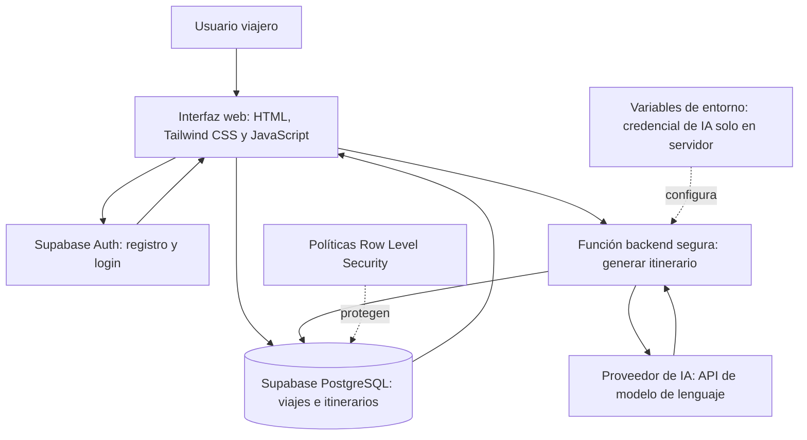
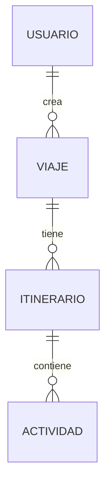

# TripGenius — Mapa de arquitectura del MVP

**Sesión:** 01 — De una Idea a una Aplicación con Vibe Coding  
**Entregable:** E01-05 — Mapa de arquitectura  
**Estado:** Arquitectura conceptual propuesta; su diseño técnico definitivo corresponde a la Sesión 2.

## 1. Objetivo

Definir las capas de TripGenius y sus relaciones antes de escribir código. El proyecto generará itinerarios para destinos del Perú, permitirá autenticación obligatoria y guardará los resultados por usuario.

## 2. Mapa de componentes

## 3. Responsabilidades de las capas

| Componente | Responsabilidad |
|---|---|
| Frontend | Formularios, navegación, estados de carga/error, visualización por días y resumen de costos. |
| Supabase Auth | Registro, inicio/cierre de sesión y gestión segura de identidad. |
| PostgreSQL (Supabase) | Persistencia de viajes, itinerarios, actividades y costos estimados. |
| RLS | Aislar los registros de cada usuario autenticado. |
| Backend seguro | Verificar sesión y entradas, recuperar contexto, invocar IA y validar su respuesta. |
| API de IA | Proponer actividades, horarios y costos aproximados en una estructura JSON definida. |
| Git/GitHub | Historial y control de cambios del proyecto. |
| Hosting público | Publicar el frontend; la elección/configuración definitiva se hará en sesiones posteriores. |

## 4. Entidades conceptuales (sin fijar todavía SQL)

- **Usuario:** identidad autenticada administrada por Supabase Auth.
- **Viaje:** usuario propietario, destino, duración, presupuesto en PEN e intereses.
- **Itinerario:** viaje asociado, fecha de generación, resumen y costo estimado total.
- **Actividad:** itinerario, día, horario sugerido, nombre, descripción y costo estimado.

Relaciones conceptuales:

## 5. Flujo técnico de generación con IA

1. El usuario autenticado completa las preferencias.
2. El frontend verifica campos básicos y envía una petición al backend seguro.
3. El backend comprueba autenticación, valida el contenido y llama a la API de IA con credenciales almacenadas solo en el servidor.
4. La IA devuelve una propuesta de itinerario estructurado en JSON.
5. El backend valida estructura, número de días, datos obligatorios y montos numéricos.
6. Se devuelve una propuesta a la interfaz, mostrando estimaciones y posibles advertencias presupuestarias.
7. Si el usuario elige guardar, los datos se persisten asociados a su identidad; las políticas RLS impiden acceso cruzado.
8. Si la IA falla, el usuario recibe un mensaje y puede reintentar sin perder sus preferencias.

## 6. Reglas de seguridad y calidad

- Nunca exponer la API Key del proveedor de IA en JavaScript público ni en GitHub.
- No almacenar secretos reales en documentación o capturas académicas.
- Configurar políticas RLS para operaciones de lectura y escritura sobre datos privados.
- Tratar las respuestas del modelo como datos no confiables: validar JSON y campos antes de guardar.
- Los costos y horarios son referenciales, sin consultas de disponibilidad real en el MVP.
- Priorizar un solo flujo completo y comprobable antes de añadir funcionalidades secundarias.

## 7. Decisiones pendientes para la Sesión 2

- Proveedor y modelo de IA.
- Función backend concreta (por ejemplo, Supabase Edge Function u otra alternativa compatible).
- Definición SQL exacta, índices, restricciones y políticas RLS.
- Estructura definitiva de archivos y componentes.
- Duración mínima y máxima del viaje.
- Estrategia de despliegue y límites de consumo/costo.

## 8. Evidencia académica

**E01-05:** este documento `arquitectura.md` y una captura del mapa renderizado una vez revisado. La aprobación queda pendiente hasta validación del responsable del proyecto.
