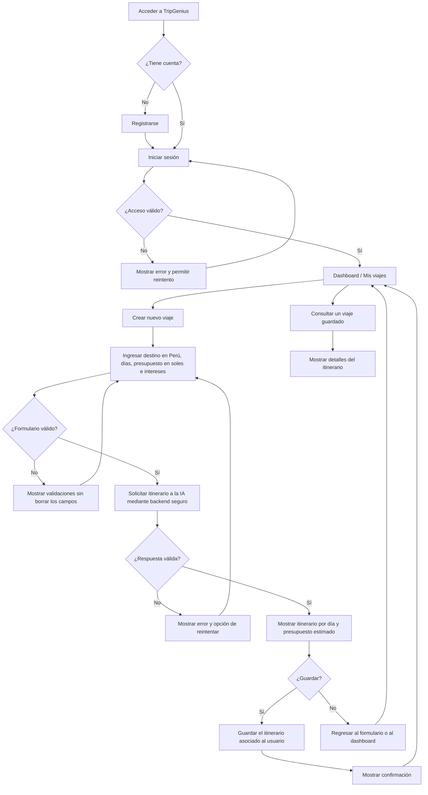

# TripGenius — User Flow del MVP

**Sesión:** 01 — De una Idea a una Aplicación con Vibe Coding  
**Entregable:** E01-04 — User Flow  
**Estado:** Propuesta para revisión  
**Base:** Product Brief aprobado y las historias HU-01 a HU-06.

## 1. Objetivo

Describir el recorrido del viajero, desde el acceso autenticado hasta la generación, visualización, guardado y recuperación de un itinerario turístico dentro del Perú.

## 2. Flujo principal

## 3. Pantallas previstas (funcionales, no diseño definitivo)

| Vista | Propósito | Acciones clave |
|---|---|---|
| Inicio / Login | Controlar el acceso obligatorio | Iniciar sesión, ir a registro |
| Registro | Crear una cuenta | Completar datos de acceso y registrarse |
| Dashboard / Mis viajes | Punto de entrada autenticado | Crear viaje, consultar guardados, cerrar sesión |
| Crear viaje | Capturar preferencias | Elegir destino del Perú, duración, presupuesto e intereses |
| Resultado del itinerario | Mostrar respuesta generada | Explorar días, actividades y estimación de gastos; guardar |
| Detalle guardado | Recuperar información persistente | Consultar un itinerario anterior |

## 4. Flujos alternativos y errores

1. **Acceso inválido:** mantener al usuario en el login e informar el problema sin revelar detalles sensibles.
2. **Formulario incompleto o inválido:** impedir el envío y señalar los campos que deben corregirse.
3. **Falla o respuesta inválida de IA:** mostrar mensaje comprensible y ofrecer reintento conservando las preferencias.
4. **Presupuesto insuficiente para una propuesta realista:** indicar que los costos son referenciales y advertir cuando el estimado exceda el presupuesto.
5. **Error al guardar:** conservar el itinerario visible y permitir reintentar.
6. **Sin viajes guardados:** mostrar un estado vacío con la acción «Crear mi primer viaje».
7. **Acceso a datos de otra cuenta:** denegar consulta o modificación de itinerarios ajenos.

## 5. Reglas y límites del flujo

- La sesión es obligatoria antes de generar o consultar itinerarios.
- Los destinos permitidos están dentro del Perú.
- El presupuesto se ingresa en soles (PEN) y **no incluye transporte para llegar al destino**.
- Los horarios y costos de la IA son **estimaciones**, no precios o disponibilidad en tiempo real.
- La duración máxima y mínima del viaje queda **pendiente de confirmación**. No aplicar todavía un límite de 2 a 5 días como regla cerrada.
- No hay reservas, pagos, navegación GPS ni optimización avanzada de rutas en el MVP.

## 6. Verificación del User Flow

- [ ] Es posible completar el recorrido login → nuevo viaje → generar → visualizar → guardar → consultar.
- [ ] Los errores de autenticación, formulario e IA tienen una salida comprensible.
- [ ] Ningún viaje guardado puede ser consultado por otro usuario.
- [ ] El presupuesto muestra claramente su alcance y carácter referencial.
- [ ] El responsable del proyecto revisó y aprobó este flujo.

## 7. Evidencia académica

**E01-04:** este archivo `user_flow.md` y, una vez revisado, una captura del diagrama renderizado o de su revisión en el editor. No se considera aprobado hasta confirmación del responsable.
