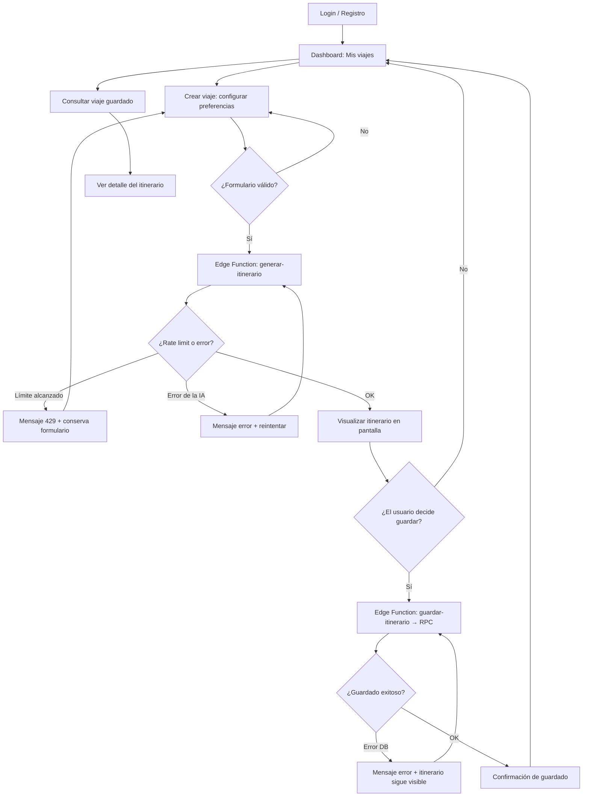
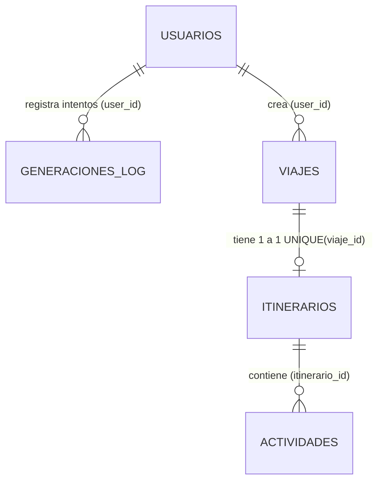
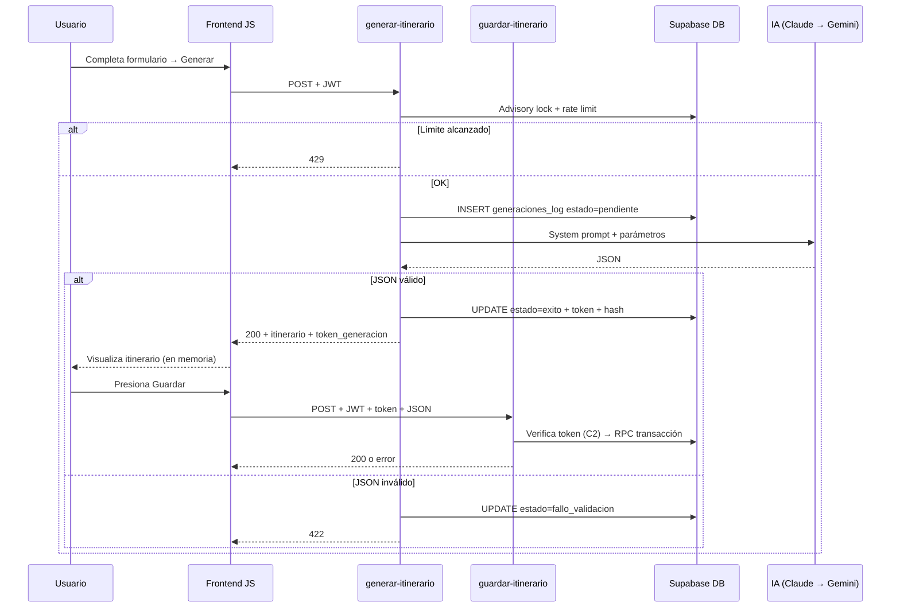
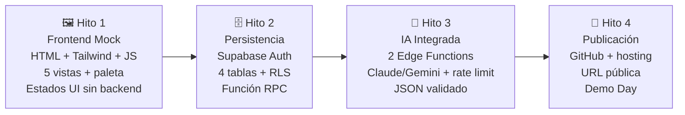

# Plan de Arquitectura MVP — TripGenius (v3 — Aprobado con condiciones)

> **Documentos base:** CLAUDE.md · product_brief.md · historias_usuario.md · criterios_aceptacion.md · user_flow.md · arquitectura.md
> **Estado:** ✅ Aprobado — condicionado a implementar las correcciones de seguridad de la Sección 14 antes de ejecutar los Hitos 2 y 3.
> **Sesión:** 02 — Prompting y Context Engineering · DMC Institute

---

## 🔒 Decisiones técnicas cerradas

| # | Decisión | Valor confirmado |
|---|---|---|
| D1 | Cobertura geográfica | Solo destinos del **Perú** |
| D2 | Duración del viaje | **2 a 5 días** (regla oficial aprobada) |
| D3 | Autenticación | **Obligatoria** — Supabase Auth (email + confirmación) |
| D4 | Moneda | **PEN (S/)** — excluye transporte hasta el destino |
| D5 | Backend seguro | **Supabase Edge Functions** (Deno/TypeScript) |
| D6 | Proveedor de IA | **Claude (Anthropic)** como principal y **Gemini** de respaldo automático, configurables por variables de entorno (cambio aprobado el 20 Oct 2026; ver `plan_hito_03.md`, sección 2.1) |
| D7 | Límite de generación | **5 solicitudes por usuario por día** (contabiliza intentos, no solo guardados) |
| D8 | Paleta visual | **Azul profundo + Turquesa + Blanco** — interfaz moderna en español |
| D9 | Persistencia | **Función PostgreSQL via RPC** — transacción atómica |
| D10 | Flujo de generación/guardado | **Operaciones separadas** — la IA genera y devuelve; el usuario decide guardar |

---

## 📌 Decisiones pendientes

| # | Decisión | Por definir en |
|---|---|---|
| P1 | Modelo exacto de IA ✅ | Resuelto: Claude `claude-opus-5-5` (principal) → Gemini (respaldo) |
| P2 | Política de rotación de las API Keys (Anthropic y Gemini) ✅ | Resuelto en Hito 3: Supabase Secrets, rotación periódica |
| P3 | Plataforma de hosting definitiva | Inicio Hito 4 |
| P4 | Componentes visuales detallados ✅ | Aprobado al iniciar Hito 1 |

---

## 1. Estructura de archivos del proyecto

> Actualizada el 20 Oct 2026 para reflejar la estructura real tras los Hitos 1–3. Cambios respecto a la v3: no existe la Edge Function `guardar-itinerario` (decisión D-A del Hito 3: el guardado usa la RPC con token); los planes de cada hito están en carpetas propias (`03_`, `04_`, `05_`); no hay `css/styles.css` (Tailwind por CDN); se eliminó `evidencias/`.

```text
TRIPGENIUS/
│
├── CLAUDE.md
├── README.md
├── .gitignore                                 # Excluye .env*, node_modules, temporales de Supabase
│
├── docs/
│   ├── 01_idea_blueprint/                     # ✅ NO modificar — Blueprint aprobado Sesión 1
│   ├── 02_context_engineering/
│   │   ├── master_prompt.md
│   │   ├── plan_arquitectura.md               # este archivo (plan base)
│   │   ├── roadmap.md
│   │   └── README.md
│   ├── 03_frontend/
│   │   └── plan_hito1.md                      # Hito 1 — Frontend Mock
│   ├── 04_backend_supabase/
│   │   └── plan_hito2.md                      # Hito 2 — Supabase, RLS, RPC
│   └── 05_integracion_ia/
│       ├── plan_hito_03.md                    # Hito 3 — IA (Claude + Gemini de respaldo)
│       ├── itinerary_schema.json              # Contrato JSON del itinerario
│       └── system_prompt_itinerario.md        # Diseño del prompt de sistema
│
├── supabase/
│   ├── config.toml                            # verify_jwt = false (JWT verificado en la función)
│   ├── functions/
│   │   └── generar-itinerario/
│   │       ├── index.ts                       # JWT, cupo atómico, Claude/Gemini, validación, token
│   │       ├── prompt.ts                      # Prompt de sistema
│   │       └── esquema.ts                     # Esquema JSON de salida estructurada
│   └── migrations/
│       ├── 001_schema_inicial.sql             # Hito 2 — tablas, RLS, RPC
│       └── 002_generacion_ia.sql              # Hito 3 — rate limit, token, RPC con token
│
└── src/
    ├── index.html                             # Login (HU-01)
    ├── register.html                          # Registro (HU-02)
    ├── dashboard.html                         # Mis viajes (HU-06)
    ├── crear-viaje.html                       # Configurar viaje (HU-03)
    ├── itinerario.html                        # Resultado + Guardar (HU-04, HU-05)
    └── js/
        ├── supabase-client.js                 # Cliente con publishable key + guard de sesión
        ├── comun.js                           # escapeHtml, etiquetas de intereses, formato S/
        ├── mock-store.js                      # Borrador del itinerario generado (sessionStorage)
        ├── auth.js
        ├── viaje.js
        ├── itinerario.js
        └── mis-viajes.js
```

---

## 2. User Flow implementado (alineado con E01-04)



> [!IMPORTANT]
> La generación con IA y el guardado son **operaciones independientes**. El itinerario generado vive en el estado del frontend hasta que el usuario presiona "Guardar".

---

## 3. Tablas de Supabase (PostgreSQL)

### 3.1 `generaciones_log`

| Columna | Tipo | Restricción | Descripción |
|---|---|---|---|
| `id` | `uuid` | PK, `gen_random_uuid()` | Identificador único |
| `user_id` | `uuid` | FK → `auth.users.id`, NOT NULL | Usuario que solicitó |
| `estado` | `text` | NOT NULL, CHECK IN ('pendiente','exito','fallo_proveedor','fallo_validacion') | Resultado del intento |
| `token_generacion` | `uuid` | UNIQUE | Token de un solo uso (ver C2) |
| `hash_itinerario` | `text` | | SHA-256 del JSON validado |
| `expira_en` | `timestamptz` | | now() + 30 minutos |
| `token_usado` | `boolean` | default `false` | Impide reusos del token |
| `created_at` | `timestamptz` | NOT NULL, default `now()` | Momento del intento |

### 3.2 `viajes`

| Columna | Tipo | Restricción | Descripción |
|---|---|---|---|
| `id` | `uuid` | PK, `gen_random_uuid()` | Identificador único |
| `user_id` | `uuid` | FK → `auth.users.id`, NOT NULL | Propietario |
| `destino` | `text` | NOT NULL | Destino dentro del Perú |
| `dias` | `integer` | NOT NULL, CHECK (dias BETWEEN 2 AND 5) | Duración confirmada |
| `presupuesto` | `numeric(10,2)` | NOT NULL, CHECK (presupuesto > 0) | En PEN, sin transporte |
| `intereses` | `text[]` | NOT NULL | cultura, aventura, gastronomia, naturaleza, familiar |
| `created_at` | `timestamptz` | default `now()` | Fecha de creación |

### 3.3 `itinerarios`

| Columna | Tipo | Restricción | Descripción |
|---|---|---|---|
| `id` | `uuid` | PK, `gen_random_uuid()` | Identificador único |
| `viaje_id` | `uuid` | FK → `viajes.id`, ON DELETE CASCADE, **UNIQUE** | Relación 1:1 con viaje |
| `user_id` | `uuid` | FK → `auth.users.id`, NOT NULL | Para RLS directo |
| `costo_total_estimado` | `numeric(10,2)` | CHECK (>= 0) | Suma de actividades estimadas |
| `advertencia_presupuesto` | `boolean` | NOT NULL, default `false` | True si costo supera presupuesto |
| `json_raw` | `jsonb` | NOT NULL | Respuesta validada de la IA |
| `created_at` | `timestamptz` | default `now()` | Fecha de guardado |

### 3.4 `actividades`

| Columna | Tipo | Restricción | Descripción |
|---|---|---|---|
| `id` | `uuid` | PK, `gen_random_uuid()` | Identificador único |
| `itinerario_id` | `uuid` | FK → `itinerarios.id`, ON DELETE CASCADE | Itinerario al que pertenece |
| `dia` | `integer` | NOT NULL, CHECK (dia >= 1) | Número de día (1…N) |
| `hora_sugerida` | `text` | | Ej. "09:00" |
| `nombre` | `text` | NOT NULL | Nombre de la actividad |
| `descripcion` | `text` | | Descripción breve |
| `costo_estimado` | `numeric(10,2)` | CHECK (>= 0) | En PEN; NULL si no disponible |
| `costo_no_estimado` | `boolean` | NOT NULL, default `false` | `true` = IA no pudo estimar |

### 3.5 Relaciones



---

## 4. Políticas Row Level Security (RLS)

> [!CAUTION]
> RLS habilitado en las 4 tablas antes de insertar datos reales.

### 4.1 `generaciones_log` — Solo lectura para el cliente (C3)
```sql
ALTER TABLE generaciones_log ENABLE ROW LEVEL SECURITY;
CREATE POLICY "gen_log_select_own" ON generaciones_log
  FOR SELECT USING (auth.uid() = user_id);
-- Sin INSERT, UPDATE ni DELETE para el cliente. Solo service_role (Edge Function).
```

### 4.2 `viajes`
```sql
ALTER TABLE viajes ENABLE ROW LEVEL SECURITY;
CREATE POLICY "viajes_select_own" ON viajes FOR SELECT USING (auth.uid() = user_id);
CREATE POLICY "viajes_insert_own" ON viajes FOR INSERT WITH CHECK (auth.uid() = user_id);
```

### 4.3 `itinerarios`
```sql
ALTER TABLE itinerarios ENABLE ROW LEVEL SECURITY;
CREATE POLICY "itinerarios_select_own" ON itinerarios FOR SELECT USING (auth.uid() = user_id);
-- INSERT delegado a función RPC SECURITY DEFINER
```

### 4.4 `actividades`
```sql
ALTER TABLE actividades ENABLE ROW LEVEL SECURITY;
CREATE POLICY "actividades_select_own" ON actividades
  FOR SELECT USING (
    EXISTS (
      SELECT 1 FROM itinerarios
      WHERE itinerarios.id = actividades.itinerario_id
        AND itinerarios.user_id = auth.uid()
    )
  );
-- INSERT delegado a función RPC SECURITY DEFINER
```

---

## 5. Función PostgreSQL RPC — Persistencia atómica

La función `guardar_itinerario_completo` se invoca desde la Edge Function `guardar-itinerario` mediante `supabase.rpc(...)`. Ejecuta los tres INSERT en una única transacción con ROLLBACK automático ante cualquier error.

**Firma (pseudocódigo — no es código ejecutable):**

```
FUNCTION guardar_itinerario_completo(
  -- Sin p_user_id — se obtiene de auth.uid() en el servidor (C1)
  p_destino      text,
  p_dias         integer,
  p_presupuesto  numeric,
  p_intereses    text[],
  p_token_gen    uuid,      -- token de generación de un solo uso (C2)
  p_actividades  jsonb,
  p_json_raw     jsonb,
  p_costo_total  numeric,
  p_advertencia  boolean
)
RETURNS uuid
SECURITY DEFINER
SET search_path = public, pg_temp   -- (C1) evita ataques de sustitución de esquema
AS $$
  v_user_id := auth.uid();          -- identidad del servidor, nunca del cliente
  -- Verifica token de un solo uso (C2)
  -- INSERT viajes → viaje_id
  -- INSERT itinerarios → itinerario_id (UNIQUE(viaje_id) actúa aquí)
  -- INSERT masivo actividades desde JSONB
  -- RETURN itinerario_id
$$;
```

**Regla de costo total:**
- `costo_no_estimado = false` → suma al total.
- `costo_no_estimado = true` → no suma; nunca se imputa como cero.
- `advertencia_presupuesto = true` si `costo_total > presupuesto`.

---

## 6. Rate limit — Registro de intentos

Límite de 5 solicitudes/usuario/día en `generaciones_log`. Contabiliza **intentos**, no guardados.

**Prevención de concurrencia (C4):** advisory lock por `user_id` serializa las solicitudes. Solo se rechaza cuando el conteo al entrar al lock es ≥ 5.

| Intentos usados | Solicitudes simultáneas | Resultado |
|:---:|:---:|---|
| 3 | 2 | Ambas pasan (→ 4 y 5) |
| 4 | 2 | Una pasa (→ 5), la otra recibe 429 |
| 5 | cualquier número | Todas reciben 429 |

| Situación | ¿Cuenta? |
|---|:---:|
| Generación exitosa | ✅ |
| Fallo del proveedor de IA (503) | ✅ |
| JSON inválido de la IA | ✅ |
| JWT inválido | ❌ |
| Datos inválidos (bloqueado en frontend) | ❌ |
| Usuario no guarda el resultado | ✅ |

---

## 7. Flujo técnico completo



---

## 8. Manejo de errores

| Situación | HTTP | Usuario |
|---|---|---|
| JWT inválido | 401 | "Tu sesión expiró. Inicia sesión de nuevo." |
| Campos inválidos | — | Campo resaltado + mensaje específico |
| Destino fuera del Perú | — | "La cobertura está limitada al Perú." |
| Días fuera de rango | — | "La duración debe ser entre 2 y 5 días." |
| Rate limit alcanzado | 429 | "Alcanzaste el límite de hoy. Vuelve mañana." |
| Fallo de la IA | 503 | "No se pudo generar. Intenta de nuevo." |
| JSON de la IA inválido | 422 | "Respuesta inesperada. Intenta de nuevo." |
| Token expirado o manipulado | 403 | "Sesión de generación inválida. Genera de nuevo." |
| Costo > presupuesto | — | Banner ámbar con diferencia en S/ |
| Error de transacción RPC | 500 | "No se pudo guardar. El itinerario sigue visible." |
| UNIQUE(viaje_id) violado | 409 | "Este viaje ya tiene un itinerario guardado." |
| Acceso a datos ajenos | — | Sin acceso (RLS devuelve vacío) |
| Sin viajes guardados | — | "Aún no tienes viajes. ¡Crea el primero!" |

---

## 9. Esquema JSON de respuesta de la IA

```json
{
  "destino": "Cusco",
  "dias": 3,
  "presupuesto_ingresado": 800.00,
  "costo_total_estimado": 720.00,
  "advertencia_presupuesto": false,
  "itinerario": [
    {
      "dia": 1,
      "actividades": [
        {
          "hora_sugerida": "09:00",
          "nombre": "Visita Plaza de Armas",
          "descripcion": "Recorrido por el centro histórico de Cusco.",
          "costo_estimado": 0.00,
          "costo_no_estimado": false
        },
        {
          "hora_sugerida": "15:00",
          "nombre": "Mercado de San Pedro",
          "descripcion": "Visita al mercado tradicional cusqueño.",
          "costo_estimado": null,
          "costo_no_estimado": true
        }
      ]
    }
  ],
  "nota_descargo": "Horarios, tarifas y disponibilidad son estimaciones referenciales, no verificadas en tiempo real."
}
```

**Campos obligatorios validados:** `destino`, `dias` (igual al solicitado), `itinerario` (array de exactamente `dias` elementos), `nombre` en cada actividad, `costo_no_estimado` (boolean explícito), `nota_descargo`.

---

## 10. Paleta visual

| Rol | Color | Hex |
|---|---|---|
| Primario | Azul profundo | `#1E3A5F` |
| Acento | Turquesa | `#2EC4B6` |
| Fondo | Blanco | `#FFFFFF` |
| Texto | Gris oscuro | `#1F2937` |
| Advertencia | Ámbar | `#F59E0B` |
| Error | Rojo suave | `#EF4444` |
| Éxito | Verde | `#10B981` |

---

## 11. Pruebas clave por historia de usuario

| HU | Prueba nominal | Prueba de error | Prueba de seguridad |
|---|---|---|---|
| HU-01 | Login válido → dashboard | Credenciales inválidas → error sin revelar cuál falló | Sin sesión → redirige a login |
| HU-02 | Registro exitoso → confirmación | Email duplicado → respuesta neutra | Contraseña débil → mensaje de política |
| HU-03 | Formulario completo → genera | Campo vacío → bloquea con mensaje | Destino fuera del Perú → bloqueado |
| HU-04 | JSON válido → itinerario visible | La IA falla → formulario conservado | 5 intentos agotados → 429 |
| HU-04 concurrencia | 2 solicitudes con 3 intentos usados → ambas pasan | — | Advisory lock serializa correctamente |
| HU-05 | Costo < presupuesto → sin advertencia | Costo > presupuesto → banner ámbar | Costo no estimado no suma al total |
| HU-06 | Guardar → confirmación → en Mis viajes | Error DB → itinerario visible | viaje_id ajeno → RLS devuelve vacío |
| HU-06 1:1 | Un itinerario por viaje → éxito | Segundo intento → 409 UNIQUE | Token manipulado → 403 |

---

## 12. Roadmap en 4 hitos



Ver `roadmap.md` para estado actualizado de cada hito.

---

## 13. Riesgos y mitigación

| Riesgo | Prob. | Impacto | Mitigación |
|---|---|---|---|
| La IA devuelve JSON malformado | Alta | Alto | Validación estricta en Edge Function |
| Exposición de API Keys | Baja | Crítico | Solo en secretos Supabase; `.gitignore` revisado |
| Acceso cruzado entre usuarios | Baja | Alto | RLS + RPC SECURITY DEFINER con auth.uid() |
| Solicitudes concurrentes | Media | Medio | Advisory lock por user_id |
| Registros parciales en DB | Baja | Alto | Transacción única en RPC; ROLLBACK automático |
| Costos inesperados de la IA | Media | Medio | Rate limit 5/usuario/día |
| Scope creep | Media | Medio | CLAUDE.md como árbitro de alcance |

---

## 14. Condiciones de seguridad obligatorias (C1–C4)

> [!IMPORTANT]
> Ningún hito se considera completo sin que sus condiciones estén implementadas **y** probadas.

| Condición | Descripción | Hito impl. | Hito prueba |
|---|---|:---:|:---:|
| **C1** | RPC usa `auth.uid()` del servidor + `search_path` explícito | 2 | 2 |
| **C2** | Token de generación de un solo uso + verificación de hash SHA-256 | 3 | 3 |
| **C3** | `generaciones_log` sin permisos de escritura para el cliente | 2 | 3 |
| **C4** | Advisory lock serializa solicitudes — no rechaza por ser simultáneas | 3 | 3 |

---

> **Estado del plan:** ✅ Aprobado con condiciones C1–C4
> **Hito 1:** ✅ Completado — detalle en `docs/03_frontend/plan_hito1.md`
> **Hito 2:** ✅ Completado — detalle, aprobación y desviaciones respecto a este plan en `docs/04_backend_supabase/plan_hito2.md`
> **Hito 3:** ✅ Completado — detalle, decisiones y pruebas en `docs/05_integracion_ia/plan_hito_03.md`
> **Hito 4:** ✅ Completado — publicado en https://danyhuancag.github.io/tripgenius/ (`docs/06_despliegue/plan_hito_04.md`)
>
> Este documento es el plan base v3. Las desviaciones aprobadas en cada hito (p. ej. `search_path = ''`,
> eliminación de `viajes_insert_own`, costo total recalculado en servidor) se registran en el plan de
> cada hito, no aquí.
